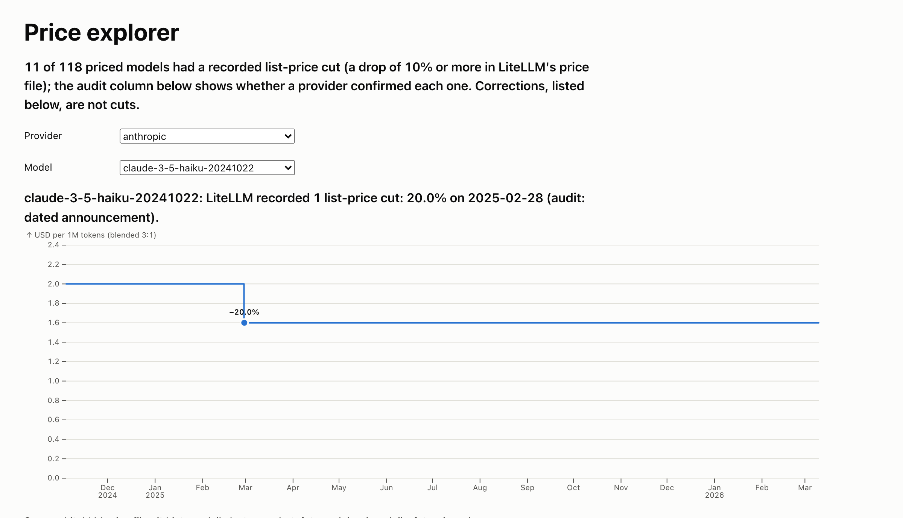
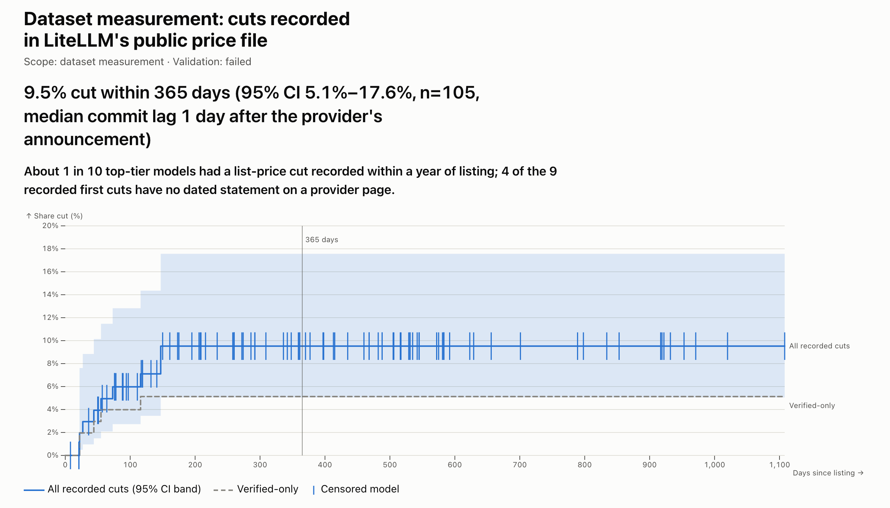
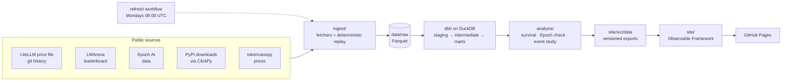

<h1 align="center">LLM Market Observatory</h1>

<p align="center">
  <strong>Do top-tier LLMs ever cut their launch price?</strong><br>
  A governed, tested daily history of first-party LLM API list prices, rebuilt from the git history of
  LiteLLM's public price file since 2023-09-06.
</p>

<p align="center">
  <a href="https://github.com/Sanjaayyy7/llm-market-observatory/actions/workflows/ci.yml"></a>
  <a href="https://github.com/Sanjaayyy7/llm-market-observatory/actions/workflows/pages.yml"></a>
  <a href="https://github.com/Sanjaayyy7/llm-market-observatory/actions/workflows/refresh.yml"></a>
  <a href="LICENSE"></a>
</p>

<p align="center">
  <a href="https://sanjaayyy7.github.io/llm-market-observatory/"><strong>Live site</strong></a> ·
  <a href="#get-the-data">Get the data</a> ·
  <a href="https://sanjaayyy7.github.io/llm-market-observatory/methods">Methods</a> ·
  <a href="docs/README.md">Docs</a>
</p>



## Result

- **No market estimate in v1.0.** The pre-registered validation against Epoch AI failed: LiteLLM's
  public price file missed provider price cuts we verified on provider pages (Gemini 1.5 Pro on
  2024-10-01, Mistral Large 2 on 2024-09-17). The kill criterion's own action applies, so the project
  publishes no market-wide number ([pre-registration](docs/prereg/epoch-check.md),
  [design §18](docs/03-spec/design.md)).
- **What it publishes instead:**
  - a governed SCD2 history of first-party list prices;
  - a labelled *dataset measurement* of the cuts LiteLLM recorded (Kaplan–Meier, with an audit-based
    lower bound and a competing-risk check);
  - a descriptive SDK-adoption view that stays below its pre-registered floor of 8 events.
- Values change with each weekly refresh, so they live on the [site](https://sanjaayyy7.github.io/llm-market-observatory/) and in the
  [data files](#get-the-data). Every page carries a stamp naming the data dates and the LiteLLM commit.



## Get the data

The published files are versioned in this repository and refreshed every Monday at 06:00 UTC; the git
history of [`site/src/data/`](site/src/data/) is their change log.

| File | One row per | What it holds |
|---|---|---|
| [`price_daily.parquet`](https://raw.githubusercontent.com/Sanjaayyy7/llm-market-observatory/main/site/src/data/price_daily.parquet) | model × LiteLLM snapshot day | Blended list price while the model is listed |
| [`price_changes.parquet`](https://raw.githubusercontent.com/Sanjaayyy7/llm-market-observatory/main/site/src/data/price_changes.parquet) | recorded price change | Old and new blended price, change, and whether it is a cut or a correction |
| [`models.parquet`](https://raw.githubusercontent.com/Sanjaayyy7/llm-market-observatory/main/site/src/data/models.parquet) | canonical model | Provider, family, display name, open weights, announcement date and URL |
| [`survival.parquet`](https://raw.githubusercontent.com/Sanjaayyy7/llm-market-observatory/main/site/src/data/survival.parquet) | top-tier model | Listing date, first cut (if any), days at launch price, censoring, cut depth |
| [`cut_audit.parquet`](https://raw.githubusercontent.com/Sanjaayyy7/llm-market-observatory/main/site/src/data/cut_audit.parquet) | audited first cut | Recorded and announced dates, lag, evidence URL and audit verdict |
| [`headline.json`](https://raw.githubusercontent.com/Sanjaayyy7/llm-market-observatory/main/site/src/data/headline.json) | — | The dataset measurement, its 95% CI and the verified-only bound |

DuckDB reads them straight from GitHub (its `httpfs` extension loads automatically for `https://` paths):

```sql
select date, blended_per_mtok
from 'https://raw.githubusercontent.com/Sanjaayyy7/llm-market-observatory/main/site/src/data/price_daily.parquet'
where canonical_model_id = 'o3-2025-04-16'
order by date;
```

<details>
<summary>Field reference</summary>

| File | Field | Meaning |
|---|---|---|
| `price_daily` | `canonical_model_id` | Model ID after crosswalking provider and LiteLLM keys |
| | `date` | A LiteLLM snapshot day: a UTC day with at least one commit to the price file |
| | `blended_per_mtok` | `(3 × input + output) / 4`, USD per 1M tokens, first-party standard tier |
| `price_changes` | `change_ts` | When the new price version starts (UTC) |
| | `prev_blended`, `blended` | Blended price before and after |
| | `pct` | Fractional change; negative is a drop |
| | `is_cut` | A drop of 10% or more; the site counts a cut only when `is_correction` is false |
| | `is_correction` | Within 7 days of listing, reversed within 14 days, or undoing a rise from the previous 14 days |
| `survival` | `listed_at`, `first_cut_at` | First listing and first recorded cut (UTC) |
| | `days_at_launch_price` | Days from listing to the first cut, or to censoring |
| | `censored` | True when no cut was recorded before the data end, final delisting or a documented reroute |
| | `cut_depth_pct` | Price drop at the first cut |
| `cut_audit` | `lag_days` | Announced minus recorded date; negative means LiteLLM recorded the cut after the announcement |
| | `verdict` | `announced`, `real_undated`, `unannounced`, `no_evidence` or `reroute` |
| | `source_url` | The provider page used as evidence |

</details>

## How it works



| Path | What it holds |
|---|---|
| [`ingest/`](ingest/) | Source fetchers, freshness records, and a deterministic replay of LiteLLM's price-file git history (last commit per UTC day) into raw Parquet |
| [`dbt/`](dbt/) | The DuckDB warehouse: staging, intermediate and mart models, an SCD2 price dimension, seeds holding hand-audited evidence, and singular and unit tests |
| [`analysis/`](analysis/) | Kaplan–Meier survival with an audit-based lower bound, the Epoch AI validation, the event study, and the site export |
| [`site/`](site/) | The Observable Framework site and its Playwright smoke and accessibility suite |
| [`tests/`](tests/) | pytest suites mirroring `ingest/` and `analysis/`, with committed fixtures and golden files |
| [`docs/`](docs/) | Data sources and licenses, the decision log, pre-registrations, the spec, and the planning history |
| [`.github/workflows/`](.github/workflows/) | `ci` (every push), `pages` (deploy), `refresh` (weekly rebuild and publish) |

## Design choices

- **Replay git history instead of scraping.** The price file is versioned, so replaying the last commit
  of each UTC day gives a reproducible history: two full replays produce the same hash.
- **SCD2 in dbt.** Each price version is a row with `valid_from` and `valid_to`, so "the price on a
  date" is a join, not a guess.
- **DuckDB and Parquet, no server.** The warehouse is a single file, and CI builds every dbt model and
  test in memory on committed fixtures.
- **Decide what would falsify a result before reading it.** Analyses are pre-registered with kill
  criteria; when the Epoch validation failed, the market headline was dropped rather than reworded.
- **Evidence over inference.** Every manual model mapping and every audited cut carries a provider URL,
  and the build fails without one.
- **A static site over versioned data.** The site renders only from committed exports, so every number
  on it traces to a file, a model and a test.

## Quality gates

- **CI on every push:** ruff, pytest and `dbt build --target ci` on committed fixtures, then the site
  build, the Playwright suite (desktop, mobile and dark mode, with an axe contrast check) and a gitleaks
  secret scan.
- **Data contracts:** every table's grain is enforced by a uniqueness test; the SCD2 dimension and the
  Kaplan–Meier estimate are checked against hand-worked golden fixtures, and Kaplan–Meier is cross-checked
  between lifelines and statsmodels.
- **Pre-registration before outcomes:** the Epoch check and the event study were each pre-registered in
  their own commit before any outcome was read. [`tests/test_prereg.py`](tests/test_prereg.py) checks that
  the pre-registrations are never edited, that the Epoch seeds match their pinned hashes, and that the
  event-study code was committed after its pre-registration.
- **Fail loudly on stale data:** the weekly refresh stops before publishing if a source misses its
  freshness SLA or a new first cut has not been audited.

## Where each number comes from

| Number on the site | Model / code | Test |
|---|---|---|
| Share of top-tier models with a list-price cut recorded within 365 days (Kaplan–Meier) | [`mart_launch_price_survival`](dbt/models/marts/mart_launch_price_survival.sql), [`analysis/survival.py`](analysis/survival.py) | [`test_fit_km_matches_golden`, `test_km_matches_statsmodels`](tests/analysis/test_survival.py) |
| Verified-only lower bound | [`analysis/survival.py`](analysis/survival.py) | [`test_verified_data_fix_becomes_censored_at_end_ts`](tests/analysis/test_survival.py) |
| Recorded first cuts with no dated provider statement | [`mart_cut_audit`](dbt/models/marts/mart_cut_audit.sql), [`seed_cut_audit.csv`](dbt/seeds/seed_cut_audit.csv) | [`cut_audit_covers_scored_events`](dbt/tests/cut_audit_covers_scored_events.sql), [`cut_audit_evidence`](dbt/tests/cut_audit_evidence.sql) |
| Cut incidence with retirement as a competing risk (Aalen–Johansen) | [`analysis/export.py`](analysis/export.py) (`cut_incidence_365`) | [`test_cut_incidence_equals_one_minus_km_without_competing_events`](tests/analysis/test_export.py) |
| Epoch AI's GPT-4-level GPQA-Diamond price trend, reproduced from their pinned data | [`analysis/epoch_check.py`](analysis/epoch_check.py) | [`test_reproduces_epoch_published_factor`](tests/analysis/test_epoch_check.py) |
| Crosswalk coverage, all and closed in-scope Arena names | [`int_crosswalk_coverage`](dbt/models/intermediate/int_crosswalk_coverage.sql) | [`crosswalk_coverage_overall`](dbt/tests/crosswalk_coverage_overall.sql) (warn, disclosed), [`crosswalk_coverage_closed`](dbt/tests/crosswalk_coverage_closed.sql) |
| Uncovered names, each with a reason code and evidence URL | [`seed_crosswalk_uncovered.csv`](dbt/seeds/seed_crosswalk_uncovered.csv) | [`crosswalk_uncovered_has_reason`](dbt/tests/crosswalk_uncovered_has_reason.sql) |
| SDK downloads around first cuts (descriptive event study) | [`analysis/event_study.py`](analysis/event_study.py), [`docs/prereg/event-study.md`](docs/prereg/event-study.md) | [`test_verdict_line_below_and_at_floor`](tests/analysis/test_event_study.py) |

## Quickstart

```bash
git clone https://github.com/Sanjaayyy7/llm-market-observatory.git
cd llm-market-observatory
make            # list every target
make ci         # offline: lint, unit tests and dbt on committed fixtures
make all        # fetch → build → analyze → export → site (needs network)
make site-test  # Playwright smoke and accessibility suite on the built site
```

Prerequisites: [uv](https://docs.astral.sh/uv/), which installs the pinned Python 3.12, and Node 24
(`.nvmrc`). `make fetch` replays LiteLLM's full price-file history; later runs are incremental.

## Roadmap

- **v1.0:** tag the current release.
- **v1.1 (planned):** a pre-registered census of provider-announced list-price changes for a frozen set
  of top-tier models, with its recall bar fixed before the series is read. It is the only route to a
  market-wide number.

## Documentation

- [docs/DATA.md](docs/DATA.md): every source, what is used from it, its license, and how it is pinned
- [docs/DECISIONS.md](docs/DECISIONS.md): each choice the plan left open and each deviation, with evidence
- [docs/prereg/](docs/prereg/): the pre-registered Epoch check and event study
- [docs/03-spec/](docs/03-spec/): the PRD and the design
- [docs/README.md](docs/README.md): the index of every document, including the planning history

## Citing

GitHub's "Cite this repository" button reads [`CITATION.cff`](CITATION.cff). Please also credit the
upstream sources below.

## Acknowledgements

Data: [LiteLLM](https://github.com/BerriAI/litellm) (MIT), [LMArena](https://huggingface.co/datasets/lmarena-ai/leaderboard-dataset)
(CC BY 4.0), [Epoch AI](https://epoch.ai/data) (CC BY), PyPI download counts via
[ClickPy](https://clickpy.clickhouse.com/), and [tokencanopy](https://github.com/tokencanopy/price) (MIT); terms
per source in [docs/DATA.md](docs/DATA.md). Built with dbt, DuckDB, lifelines, statsmodels and Observable Framework.

## License

Code and documentation are released under the [MIT License](LICENSE). Data republished from the
sources keeps its own license and attribution terms, listed per source in [docs/DATA.md](docs/DATA.md).
