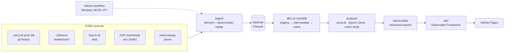

# LLM Market Observatory

A governed, tested daily history of first-party LLM API list prices, rebuilt from the git history of
LiteLLM's public price file since 2023-09-06, and an evidence-first answer to one question:
**do top-tier LLMs ever cut their launch price?**

[](https://github.com/Sanjaayyy7/llm-market-observatory/actions/workflows/ci.yml)
[](https://github.com/Sanjaayyy7/llm-market-observatory/actions/workflows/pages.yml)
[](https://github.com/Sanjaayyy7/llm-market-observatory/actions/workflows/refresh.yml)
[](LICENSE)

**Live site:** <https://sanjaayyy7.github.io/llm-market-observatory/>. It is rebuilt every Monday at
06:00 UTC, and every page carries a stamp naming the data dates and the LiteLLM commit it was built from.

## Result

- **No market estimate in v1.0.** The pre-registered validation against Epoch AI failed: LiteLLM's
  public price file missed provider price cuts we verified on provider pages (Gemini 1.5 Pro on
  2024-10-01, Mistral Large 2 on 2024-09-17). The kill criterion's own action applies, so the project
  publishes no market-wide number ([pre-registration](docs/prereg/epoch-check.md),
  [design §18](docs/03-spec/design.md)).
- **What it publishes instead:**
  - a governed SCD2 history of list prices;
  - a labelled *dataset measurement* of the cuts LiteLLM recorded (Kaplan–Meier, with an audit-based
    lower bound and a competing-risk check);
  - a descriptive SDK-adoption view that stays below its pre-registered floor of 8 events.
- Current values change with each weekly refresh, so they live on the site:
  [Home](https://sanjaayyy7.github.io/llm-market-observatory/) ·
  [Price explorer](https://sanjaayyy7.github.io/llm-market-observatory/prices) ·
  [Adoption](https://sanjaayyy7.github.io/llm-market-observatory/adoption) ·
  [Methods & data](https://sanjaayyy7.github.io/llm-market-observatory/methods).

## How it works



| Path | What it holds |
|---|---|
| [`ingest/`](ingest/) | Source fetchers, freshness records, and a deterministic replay of LiteLLM's price-file git history (last commit per UTC day) into raw Parquet |
| [`dbt/`](dbt/) | The DuckDB warehouse: staging, intermediate and mart models, an SCD2 price dimension, seeds holding hand-audited evidence, and singular and unit tests |
| [`analysis/`](analysis/) | Kaplan–Meier survival with an audit-based lower bound, the Epoch AI validation, the event study, and the site export |
| [`site/`](site/) | The Observable Framework site and its Playwright smoke and accessibility suite |
| [`tests/`](tests/) | pytest suites mirroring `ingest/` and `analysis/`, with committed fixtures and golden files |
| [`docs/`](docs/) | Data sources and licenses, the decision log, pre-registrations, the spec, and the planning history |
| [`.github/workflows/`](.github/workflows/) | `ci` (every push), `pages` (deploy), `refresh` (weekly rebuild and publish) |

## Quality gates

- **Offline CI on every push** (`make ci`): ruff, pytest and `dbt build --target ci` on committed
  fixtures, then the site build, the Playwright suite (desktop, mobile and dark mode, with an axe
  contrast check) and a gitleaks secret scan.
- **Data contracts:** every table's grain is enforced by a uniqueness test; the SCD2 dimension and the
  Kaplan–Meier estimate are checked against hand-worked golden fixtures, and Kaplan–Meier is cross-checked
  between lifelines and statsmodels.
- **Pre-registration before outcomes:** the Epoch check and the event study were each pre-registered in
  their own commit before any outcome was read. [`tests/test_prereg.py`](tests/test_prereg.py) checks that
  the pre-registrations are never edited, that the Epoch seeds match their pinned hashes, and that the
  event-study code was committed after its pre-registration.
- **Audited evidence:** every manual crosswalk row and every audited price cut carries a provider URL,
  and dbt tests fail the build without one.
- **Fail loudly on stale data:** the weekly refresh stops before publishing if a source misses its
  freshness SLA or a new first cut has not been audited.

## Where each number comes from

| Number on the site | Model / code | Test |
|---|---|---|
| Share of top-tier models with a list-price cut recorded within 365 days (Kaplan–Meier) | [`mart_launch_price_survival`](dbt/models/marts/mart_launch_price_survival.sql), [`analysis/survival.py`](analysis/survival.py) | [`test_fit_km_matches_golden`, `test_km_matches_statsmodels`](tests/analysis/test_survival.py) |
| Verified-only lower bound | [`analysis/survival.py`](analysis/survival.py) | [`test_verified_data_fix_becomes_censored_at_end_ts`](tests/analysis/test_survival.py) |
| Recorded first cuts with no dated provider statement | [`mart_cut_audit`](dbt/models/marts/mart_cut_audit.sql), [`seed_cut_audit.csv`](dbt/seeds/seed_cut_audit.csv) | [`cut_audit_covers_scored_events`](dbt/tests/cut_audit_covers_scored_events.sql), [`cut_audit_evidence`](dbt/tests/cut_audit_evidence.sql) |
| Cut incidence with retirement as a competing risk (Aalen–Johansen) | [`analysis/export.py`](analysis/export.py) (`cut_incidence_365`) | [`test_cut_incidence_equals_one_minus_km_without_competing_events`](tests/analysis/test_export.py) |
| Epoch AI's GPT-4-level GPQA-Diamond price trend, reproduced from their pinned data | [`analysis/epoch_check.py`](analysis/epoch_check.py) | [`test_reproduces_epoch_published_factor`](tests/analysis/test_epoch_check.py) |
| Crosswalk coverage, all and closed in-scope Arena names | [`int_crosswalk_coverage`](dbt/models/intermediate/int_crosswalk_coverage.sql) | [`crosswalk_coverage_overall`](dbt/tests/crosswalk_coverage_overall.sql) (warn, disclosed), [`crosswalk_coverage_closed`](dbt/tests/crosswalk_coverage_closed.sql) |
| Uncovered names, each with a reason code and evidence URL | [`seed_crosswalk_uncovered.csv`](dbt/seeds/seed_crosswalk_uncovered.csv) | [`crosswalk_uncovered_has_reason`](dbt/tests/crosswalk_uncovered_has_reason.sql) |
| SDK downloads around first cuts (descriptive event study) | [`analysis/event_study.py`](analysis/event_study.py), [`docs/prereg/event-study.md`](docs/prereg/event-study.md) | [`test_verdict_line_below_and_at_floor`](tests/analysis/test_event_study.py) |

Definitions of price, cut, correction, top tier and listing are on the site's Methods page and in the
[PRD §6](docs/03-spec/PRD.md).

## Quickstart

```bash
git clone https://github.com/Sanjaayyy7/llm-market-observatory.git
cd llm-market-observatory
make            # list every target
make ci         # offline: lint, unit tests and dbt on committed fixtures
make all        # fetch → build → analyze → export → site (needs network)
make site-test  # Playwright smoke and accessibility suite on the built site
```

Prerequisites: [uv](https://docs.astral.sh/uv/), which installs the pinned Python 3.12, and Node 24
(`.nvmrc`). `make fetch` replays LiteLLM's full price-file history; later runs are incremental.

## Documentation

- [docs/DATA.md](docs/DATA.md): every source, what is used from it, its license, and how it is pinned
- [docs/DECISIONS.md](docs/DECISIONS.md): each choice the plan left open and each deviation, with evidence
- [docs/prereg/](docs/prereg/): the pre-registered Epoch check and event study
- [docs/03-spec/](docs/03-spec/): the PRD and the design
- [docs/README.md](docs/README.md): the index of every document, including the planning history

## License

Code and documentation are released under the [MIT License](LICENSE). Data republished from the
sources keeps its own license and attribution terms, listed per source in [docs/DATA.md](docs/DATA.md).
